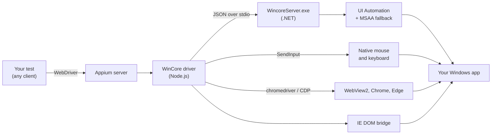

# Appium WinCore Driver

[](https://www.npmjs.com/package/appium-wincore-driver)
[](https://www.npmjs.com/package/appium-wincore-driver)
[](https://appium.io)
[](LICENSE)
[](https://github.com/appium/appium-wincore-driver/stargazers)

The official [Appium](https://appium.io) driver for Windows desktop apps.
Automate WPF, WinForms, UWP, Win32, and Internet Explorer applications
through real UI Automation, from any WebDriver client: Python, Java, C#,
JavaScript, or Ruby.

> [!TIP]
> **Coming from appium-windows-driver or WinAppDriver?**
> appium-windows-driver is deprecated and does not work with Appium 4.
> WinCore is its official replacement and needs no WinAppDriver install.
> The
> [migration guide](https://appium.github.io/appium-wincore-driver/latest/guides/migration-from-appium-windows-driver/)
> covers the client-side changes for existing suites.

## Quick start

Requires Windows 10 or later and [Node.js](https://nodejs.org).

1. Install Appium 4 and the driver:

   ```bash
   npm install -g appium
   appium driver install wincore
   ```

   On Appium 3, install the `v3` line instead:
   `appium driver install --source=npm appium-wincore-driver@3`.

1. Start the server:

   ```bash
   appium
   ```

1. Run a first test. This one adds 5 + 3 in Windows Calculator
   (`pip install Appium-Python-Client`):

   ```python
   from appium import webdriver
   from appium.options.common import AppiumOptions
   from appium.webdriver.common.appiumby import AppiumBy

   options = AppiumOptions()
   options.load_capabilities({
       "platformName": "Windows",
       "appium:automationName": "Wincore",
       "appium:app": "Microsoft.WindowsCalculator_8wekyb3d8bbwe!App",
   })
   driver = webdriver.Remote("http://127.0.0.1:4723", options=options)

   for key in ("num5Button", "plusButton", "num3Button", "equalButton"):
       driver.find_element(AppiumBy.ACCESSIBILITY_ID, key).click()

   print(driver.find_element(AppiumBy.ACCESSIBILITY_ID, "CalculatorResults").text)
   driver.quit()
   ```

   It prints `Display is 8`. The same test in Java, C#, JavaScript, and
   Ruby is in the
   [Examples guide](https://appium.github.io/appium-wincore-driver/latest/guides/examples/).

## Supported applications

| Application type | What the driver reaches |
| --- | --- |
| UWP, Win32, WinForms, WPF | Every UIA control, including RawView elements |
| Legacy grids (DevExpress, VB6) | Cells hidden behind MSAA placeholder names |
| WebView2, Chrome, Edge | Embedded web content over CDP, in the same session |
| Internet Explorer 11 | HTML content through the built-in IE DOM bridge |

Runs on Windows 10, Windows 11, and Windows Server.

## Why WinCore

| | WinCore | WinAppDriver |
| --- | :---: | :---: |
| Actively maintained | ✅ | ❌ |
| Appium 4 (and Appium 3 via `v3`) | ✅ | ❌ |
| XPath 2.0, evaluated in-process against the UIA tree | ✅ | ❌ |
| RawView elements (hidden from Control/Content view) | ✅ | ❌ |
| MSAA grid content (DevExpress, DataGridView, VB6, Delphi) | ✅ | ❌ |
| Text input independent of keyboard layout | ✅ | ❌ |
| WebView2, Chrome, and Edge content via CDP | ✅ | ❌ |
| Internet Explorer 11 via built-in IE DOM Bridge | ✅ | ❌ |

Standard accessibility values (`Value`, `LegacyValue`, …) are exposed on
every element, so content that MSAA-based grids hide behind placeholder
names is locatable without a plugin, and `windows: select` / `expand` /
`collapse` check that they took effect. See
[Locator strategies](https://appium.github.io/appium-wincore-driver/latest/reference/locator-strategies/#standard-accessibility-values).
Screen recording and a clipboard API are built in.

## How it works



The driver starts one native `WincoreServer.exe` per session and talks to it
over stdio, so there is no WinAppDriver and no PowerShell process in the
loop. Locators, XPath, and tree reads run inside
that server, next to the UI Automation tree.

## Related projects

- [wincore-mcp](https://github.com/verisoft-ai/wincore-mcp) — MCP server for AI-agent use, driving `wincore` sessions purely over the WebDriver protocol (a separate package)

## Documentation

Full documentation lives at **<https://appium.github.io/appium-wincore-driver/>**:

- [Getting Started](https://appium.github.io/appium-wincore-driver/latest/getting-started/) — install and run a first test
- [Capabilities](https://appium.github.io/appium-wincore-driver/latest/reference/capabilities/)
- [Locator strategies](https://appium.github.io/appium-wincore-driver/latest/reference/locator-strategies/)
- [`windows:` execute methods](https://appium.github.io/appium-wincore-driver/latest/reference/execute-methods/)
- [Guides](https://appium.github.io/appium-wincore-driver/latest/guides/hybrid/) — W3C Actions, hybrid mode (WebView/CDP), Internet Explorer, examples
- [Migrating from appium-windows-driver](https://appium.github.io/appium-wincore-driver/latest/guides/migration-from-appium-windows-driver/) — client-side changes for suites moving off the WinAppDriver-based driver
- [Overview](https://appium.github.io/appium-wincore-driver/latest/overview/)

The site source is in [`docs/`](docs/); see
[Contributing](https://appium.github.io/appium-wincore-driver/latest/contributing/) to preview it locally.

## Community and support

- **Questions, ideas, and show-and-tell:**
  [GitHub Discussions](https://github.com/appium/appium-wincore-driver/discussions)
- **Bugs and feature requests:**
  [GitHub Issues](https://github.com/appium/appium-wincore-driver/issues)
- **Contributing:** see [CONTRIBUTING.md](CONTRIBUTING.md)

If WinCore saves you time, please ⭐
[star the repository](https://github.com/appium/appium-wincore-driver/stargazers).
It is the simplest way to help other Windows testers find it.
