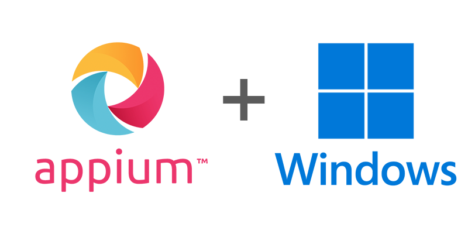

# Appium WinCore Driver

   

---

<b>
   <a href="https://appium.github.io/appium-wincore-driver/">Documentation</a> |
   <a href="https://appium.github.io/appium-wincore-driver/latest/getting-started/">Get Started</a> |
   <a href="https://appium.github.io/appium-wincore-driver/latest/guides/migration-from-appium-windows-driver/">Migration Guide</a> |
   <a href="https://github.com/appium/appium-wincore-driver/blob/main/CHANGELOG.md">Changelog</a>
</b>

---

This is an Appium driver for automating Windows desktop applications (UWP, WinForms, WPF, Win32,
and Internet Explorer) through Microsoft UI Automation.

> [!IMPORTANT]
> Since major version *4.0.0*, this driver is only compatible with Appium 4. Use the `3.x` line
> (`appium driver install --source=npm appium-wincore-driver@3`) with Appium 3.

## Coming from appium-windows-driver?

`appium-windows-driver` is deprecated and does not work with Appium 4. WinCore is its official
replacement and does not need WinAppDriver. The
[migration guide](https://appium.github.io/appium-wincore-driver/latest/guides/migration-from-appium-windows-driver/)
lists the client-side changes for existing suites.

| | WinCore | WinAppDriver |
| --- | :---: | :---: |
| Actively maintained | ✅ | ❌ |
| Appium 4 (and Appium 3 via `3.x`) | ✅ | ❌ |
| XPath 2.0, evaluated in-process against the UIA tree | ✅ | ❌ |
| RawView elements (hidden from Control/Content view) | ✅ | ❌ |
| MSAA grid content (DevExpress, DataGridView, VB6, Delphi) | ✅ | ❌ |
| Text input independent of keyboard layout | ✅ | ❌ |
| WebView2, Chrome, and Edge content via CDP | ✅ | ❌ |
| Internet Explorer 11 via built-in IE DOM Bridge | ✅ | ❌ |

## Documentation

You can access the documentation here:
[**https://appium.github.io/appium-wincore-driver**](https://appium.github.io/appium-wincore-driver)

## Related Projects

- [wincore-mcp](https://github.com/verisoft-ai/wincore-mcp): MCP server for AI-agent use, driving
  `wincore` sessions purely over the WebDriver protocol (a separate package)

## Community

Questions and ideas go to
[GitHub Discussions](https://github.com/appium/appium-wincore-driver/discussions), bugs to
[GitHub Issues](https://github.com/appium/appium-wincore-driver/issues). If the driver saves you
time, a ⭐ helps other Windows testers find it.

---

   <i>Developed and supported by</i>
    
   

