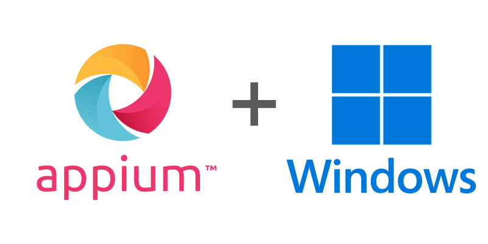

---
hide:
  - navigation
  - toc

title: Welcome
---

  

Welcome to the Appium WinCore driver documentation! The WinCore driver automates Windows desktop
applications (UWP, WinForms, WPF, Win32, WebView2 and Internet Explorer) through real UI
Automation.

The WinCore driver is part of the Appium test automation tool. For information on Appium itself,
please visit [the Appium documentation](https://appium.io).

  Developed and supported by
  

    
  

## Explore the Documentation

-   Check out the [__Overview__](./overview.md) to learn how the driver works
-   Go through the [__Getting Started__](./getting-started/index.md) steps to get set up
-   Browse the [__Reference__](./reference/capabilities.md) documentation for everything exposed by the driver
-   Read the different [__Guides__](./guides/webview.md) for a variety of instructions, tips and tricks
-   For contributions to the driver, refer to the [__Contributing__](./contributing.md) page

