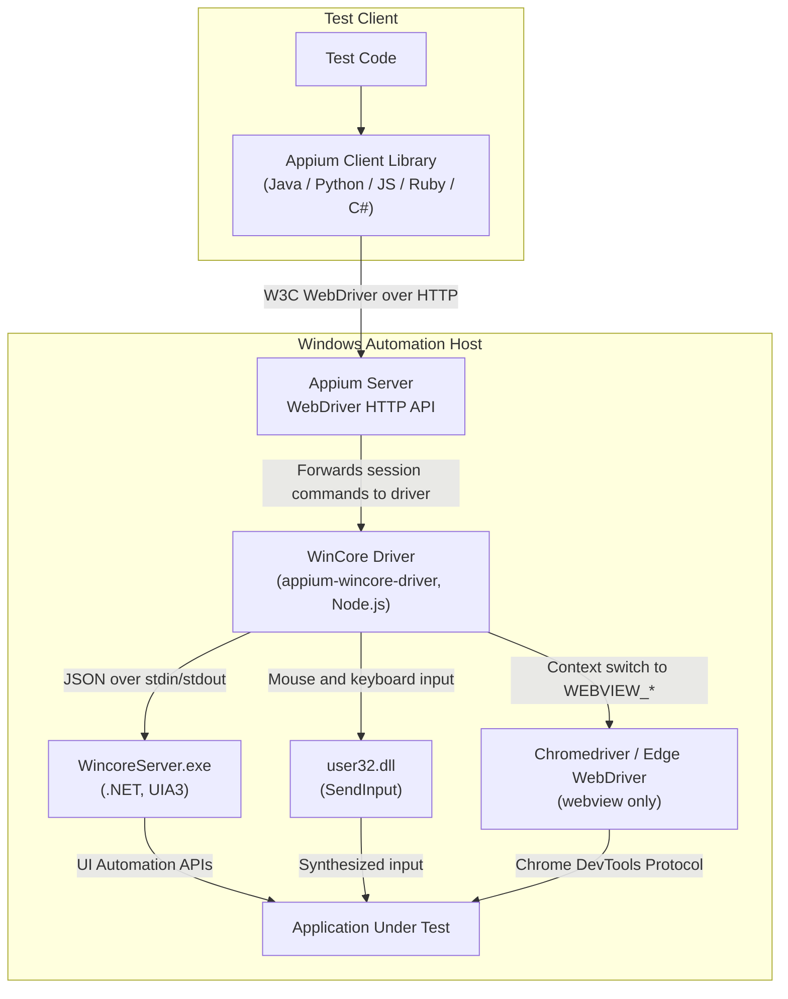

---
hide:
  - navigation

title: Overview
---

The WinCore driver is an Appium driver intended for black-box automated testing of Windows desktop
applications through the standard WebDriver API.

## Demo

  <video src="../assets/videos/driver-demo.mp4" controls muted playsinline style="width: 100%; max-width: 640px;"></video>

## Target Platforms

The driver supports the following Windows platforms as automation targets:

|Platform|Supported|
|--|--|
|Windows 10|:white_check_mark:|
|Windows 11|:white_check_mark:|
|Windows Server|:white_check_mark: [^ci-server]|
|Windows IoT|:question: [^untested]|

## Target Applications

The driver can automate any application whose user interface is exposed through
[Microsoft UI Automation](https://learn.microsoft.com/en-us/windows/win32/winauto/entry-uiauto-win32)
(UIA):

|Application type|What the driver reaches|
|--|--|
|UWP, Win32, WinForms, WPF|Every UIA-visible control, including raw-view elements hidden from the control view|
|WebView2, Chrome, Edge|Embedded web content over the Chrome DevTools Protocol, from the same session. See the [Hybrid Mode guide](./guides/webview.md)|
|Internet Explorer 11|HTML content through the built-in IE DOM bridge. See the [Internet Explorer guide](./guides/internet-explorer.md)|
|Legacy MSAA grids and controls|Content hidden behind placeholder names, through [standard accessibility values](./guides/standard-accessibility-values.md)|

The following application types are **not** supported out of the box:

* Java applications (Swing, AWT, and other JVM UI toolkits). Their controls are not exposed to UIA,
  so the driver only sees the top-level window.
* Any other application that does not expose its user interface through UIA or MSAA, for example
  applications that draw all of their controls themselves.
* Internet Explorer versions older than 11.

Support for such applications can be added with [server plugins](./contributing/server-plugins.md),
which provide element trees from outside of UIA.

## Technologies Used

The WinCore driver uses the [W3C WebDriver protocol](https://www.w3.org/TR/webdriver/) for session
management. Under the hood, the driver combines several different technologies to achieve its
functionality:

* Native testing
    * Based on [Microsoft UI Automation](https://learn.microsoft.com/en-us/windows/win32/winauto/entry-uiauto-win32)
      (UIA3), the accessibility framework that exposes the user interface of Windows applications
    * Provided by `WincoreServer.exe`, a .NET process bundled with the driver that lives for the
      length of the session. It handles element finding, UIA patterns, XPath, page source, process
      and window management, the clipboard, screenshots, file operations and PowerShell execution
    * Legacy controls with no UIA children fall back to the
      [Microsoft Active Accessibility](https://learn.microsoft.com/en-us/windows/win32/winauto/microsoft-active-accessibility)
      (MSAA) tree
* Input
    * Mouse and keyboard input is sent directly through the Windows
      [`SendInput`](https://learn.microsoft.com/en-us/windows/win32/api/winuser/nf-winuser-sendinput)
      API, called from Node.js through the [koffi](https://koffi.dev) library
* Webview testing
    * Based on [the ChromeDriver server](https://developer.chrome.com/docs/chromedriver) and
      [Microsoft Edge WebDriver](https://developer.microsoft.com/en-us/microsoft-edge/tools/webdriver/)
    * Provided by the [`appium-chromedriver`](https://github.com/appium/appium-android/tree/main/packages/chromedriver) library
* Internet Explorer testing
    * Provided by `IEBridge.exe`, a 32-bit process bundled with the driver that reads the IE DOM
      through COM
* Additional tools
    * Screen recording is handled by [FFmpeg](https://ffmpeg.org/)
    * Element trees outside of UIA can be provided by [server plugins](./contributing/server-plugins.md)

## End-to-End Architecture

The diagram below is intentionally the simplest end-to-end example. Cloud service providers, device
farms, network gateways, and sophisticated local setups may insert additional layers between the
client library and the automation host.

[^ci-server]: Covered by the driver's CI, which runs on GitHub-hosted `windows-latest` runners
[^untested]: Not tested
