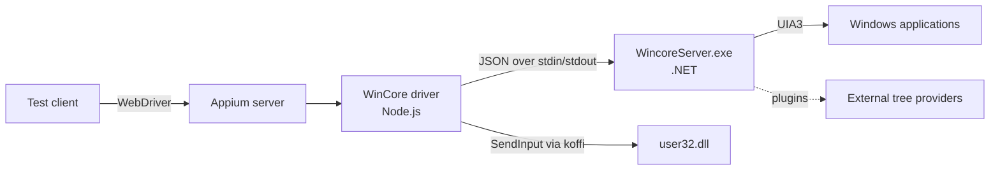

---
hide:
  - navigation

title: Overview
---

The WinCore driver is an Appium driver for automating Windows desktop applications through
the standard WebDriver API.

<video src="../assets/videos/driver-demo.mp4" controls muted playsinline style="max-width: 100%;"></video>

## Target Platforms

| Target | What the driver reaches |
| --- | --- |
| UWP, Win32, WinForms, WPF | Every UIA-visible control, including RawView elements hidden from ControlView |
| WebView2, Chrome, Edge | Embedded web content over CDP, from the same session |
| Internet Explorer 11 | Built-in IE DOM Bridge, with no IEDriverServer or extra capability |
| Legacy MSAA grids and controls | Standard accessibility values expose content hidden behind placeholder names |

## Architecture

The driver is a standard Appium driver written in TypeScript. Almost all
UI Automation work happens in a persistent .NET process, `WincoreServer.exe`,
that lives for the length of the session.



### Driver (Node.js)

`AppiumWincoreDriver` extends Appium's `BaseDriver`. Commands are grouped by
area under `lib/commands/` — element finding, W3C Actions, app and window
control, `windows:` execute methods, screen recording — and mixed into
the driver class.

### WincoreServer.exe

On `createSession` the driver spawns `WincoreServer.exe`. Requests are
newline-delimited JSON, matched to responses by id:

```json
{"id": 7, "method": "findElements", "params": {"...": "..."}}
{"id": 7, "result": ["..."], "duration_ms": 3}
```

The server owns everything that touches the UI tree or the OS: element
finding, patterns, XPath, page source, process lifecycle, window moves,
clipboard, screenshots, file operations and PowerShell execution. Its
source lives in `csharp/WincoreServer/`.

### Element finding

Appium locators are translated into condition objects that the server
rebuilds as real UIA3 `Condition`s and runs with `FindFirst` / `FindAll`
against the live tree.

XPath is evaluated in the runtime that owns the tree: the server
materialises the subtree into an `XmlDocument` and runs the whole
expression through `System.Xml.XPath`, returning matches in document
order. For legacy controls with no UIA children, the driver falls back to
walking the raw MSAA (`IAccessible`) tree.

### Input

Mouse and keyboard input bypass the server: the driver calls `SendInput`,
`SetCursorPos` and related APIs in `user32.dll` directly from Node through
the [koffi](https://koffi.dev) FFI library. W3C action chains are
translated into these calls, with optional easing curves.

### Plugins

`WincoreServer.exe` can be extended with external tree providers for
content that is not exposed through UI Automation — see
[Server plugins](./guides/server-plugins.md).
